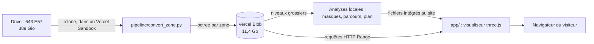

# Abbaye de la Grainetière en 3D

Visite web de l'abbaye Notre-Dame de la Grainetière (Vendée), à partir de son relevé au scanner laser : une visite guidée de 22 minutes ou une déambulation libre dans 2 milliards de points, depuis un simple navigateur.

- **En ligne :** <https://grainetiere3d.vercel.app>, en accès libre et non indexé par les moteurs de recherche. Seule `/admin`, qui ajoute les chambres des moines, demande un mot de passe.
- **Source :** 643 stations de scan, 389 Gio de fichiers E57, 19,2 milliards de points, sans couleur.
- **Publié :** 28 zones, 2,0 milliards de points, 11,4 Go compressés sur Vercel Blob.

## Comment ça marche, en bref



Les données lourdes ne passent jamais par le serveur du site : le navigateur lit directement, dans le Blob, les morceaux d'octree dont la vue a besoin. Seules les chambres passent par le serveur, pour `/admin` uniquement. Le site lui-même pèse 21 Mo, dont 20 Mo de musique.

## Contenu du dépôt

| Chemin | Rôle |
| --- | --- |
| [`app/`](app) | Le visualiseur web (Vite, three.js) et sa page de mot de passe |
| [`app/src/main.js`](app/src/main.js) | Rendu, caméra, visite, ciel, interface |
| [`app/src/cloud.js`](app/src/cloud.js) | Lecture de l'octree : sélection des points, chargement, mémoire |
| [`app/src/tour.json`](app/src/tour.json), [`places.json`](app/src/places.json) | Le parcours calculé et les textes de chaque lieu |
| [`app/middleware.js`](app/middleware.js) | La page de mot de passe |
| [`pipeline/`](pipeline) | Les scripts Python hors ligne : conversion, masques, parcours, plan |
| [`data/inventory/`](data/inventory) | L'inventaire des 643 scans et les rapports de conversion par zone |
| [`docs/`](docs) | La documentation complète |

Ne sont **pas** dans le dépôt : les scans E57 et les points convertis (sur Drive et sur Blob), les secrets (`.env.local`), `node_modules`, `.venv`, les fichiers de build et de configuration locale.

## Lancer le visualiseur en local

```bash
cd app
npm install
npm run dev
```

Par défaut, le serveur de développement lit les points du Blob public. Aucun secret n'est nécessaire, et la page de mot de passe n'existe pas en local : elle ne s'applique que sur Vercel.

## Documentation

1. [Architecture](docs/01-architecture.md) : les briques et leurs choix
2. [Données et formats](docs/02-donnees-et-formats.md) : chaque format de fichier, à l'octet près
3. [Pipeline](docs/03-pipeline.md) : chaque script, ses réglages, comment le relancer
4. [Visualiseur](docs/04-visualiseur.md) : le fonctionnement de la « soute » du navigateur
5. [Exploitation](docs/05-exploitation.md) : déployer, modifier un texte, retirer une zone, changer le mot de passe
6. [Limites, droits et chantiers](docs/06-limites-et-droits.md) : ce qui n'est pas vérifié, pas réglé ou pas fini

## Licence et crédits

Le code et la documentation sont sous licence [CC BY-NC 4.0](LICENSE.md). Cette licence **ne couvre pas les nuages de points**, fournis et réalisés par Art Graphique & Patrimoine, dont la réutilisation n'est pas autorisée, ni les textes de Philippe Gaury. La musique est de Kevin MacLeod ([incompetech.com](https://incompetech.com)), sous licence CC BY 4.0. Le détail est dans [LICENSE.md](LICENSE.md) et dans la fenêtre « Crédits » du site.

Contact : <matthieuchatry@gmail.com>
