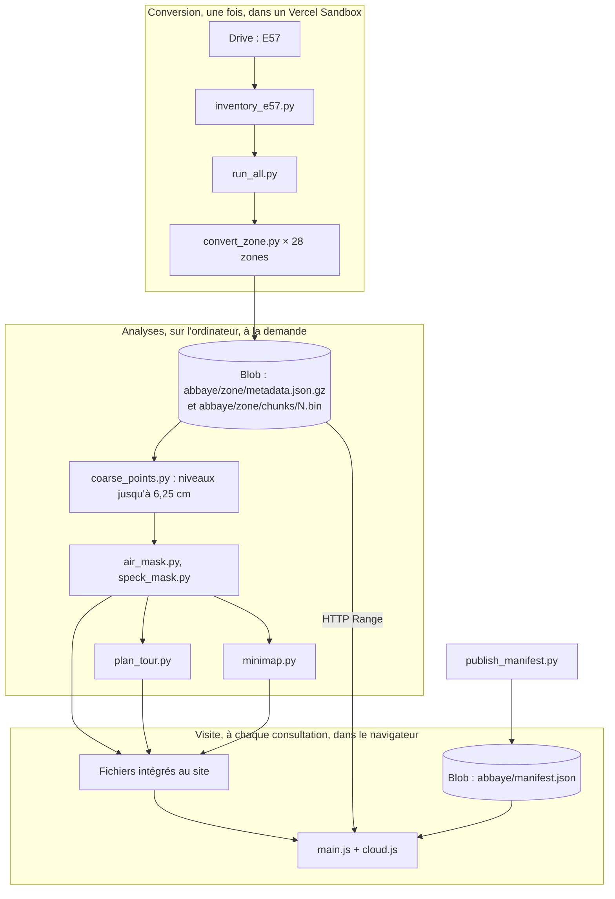

# 1. Architecture

## Le problème à résoudre

Le relevé compte 19,2 milliards de points sur 389 Gio. Un navigateur peut en afficher quelques dizaines de millions à la fois, et un ordinateur personnel ne peut pas stocker ni parcourir le tout confortablement. Il faut donc :

1. convertir les scans sans les télécharger sur une machine locale ;
2. ne faire transiter vers le navigateur que les points utiles à la vue du moment ;
3. tirer de ce nuage, sans intervention manuelle lourde, un parcours, un plan et un nettoyage.

## Les trois temps du projet

| Temps | Où | Fréquence | Sortie |
| --- | --- | --- | --- |
| Conversion | Vercel Sandbox, 8 vCPU, 16 Go | Une fois, à refaire seulement si le format change | Octrees sur Blob |
| Analyses | Ordinateur local, Python | À chaque changement de parcours, de plan ou de masque | Fichiers dans `app/src/` |
| Visite | Navigateur | À chaque consultation | Images à l'écran |

## Les choix structurants

### Convertir dans le cloud, sans disque local

Le Sandbox lit chaque E57 depuis Drive avec `rclone`, le répartit en tuiles de 16 m, supprime le scan, construit les tuiles, envoie les morceaux sur Blob et les supprime. Le disque de travail reste ainsi petit malgré les 389 Gio. Coût estimé de la conversion complète : 4 à 5 $ (estimation du script, facture non lue).

### Un octree mondial commun à toutes les zones

Toutes les zones partagent le même cube racine de 512 m et la même grille de 128 cellules par côté. Chaque zone a pourtant son propre arbre et ses propres fichiers. Cela permet :

- de convertir les zones indépendamment, et d'en relancer une seule après une panne ;
- de retirer une zone en l'enlevant du manifeste, sans toucher aux autres ;
- de superposer les zones dans le navigateur sans recalage, puisqu'elles partagent le même repère.

### Des octrees lus par plages HTTP

Chaque nœud est compressé à part, puis les nœuds sont concaténés dans des fichiers d'environ 90 Mio. Le navigateur demande uniquement la plage d'octets d'un nœud (`Range: bytes=…`). Il n'y a pas d'API ni de serveur applicatif entre le navigateur et les données, donc pas de coût de calcul côté serveur par visiteur.

### Niveau de détail progressif

Un nœud parent contient un sous-échantillon uniforme de ce qu'il couvre, et ses enfants ne répètent pas ces points : ils les complètent. Afficher un enfant revient à ajouter des points à ceux du parent, et ne demande donc jamais de retirer ceux qui sont déjà chargés.

### Le nettoyage appliqué à la lecture

Retirer un artefact des fichiers publiés demanderait de reconvertir et de renvoyer les données. Les masques suivent une autre voie : ce sont de simples listes de cellules d'espace, de quelques centaines de Ko, livrées avec le site. Le navigateur écarte à la lecture les points qui y tombent. Corriger le nettoyage revient à redéployer le site, sans toucher au Blob. Le bouton qui masque les silhouettes de l'équipe de relevé repose sur la même approche ([détail](06-limites-et-droits.md#masquer-les-silhouettes-de-léquipe-de-relevé)).

### Un rendu qui compense l'absence de couleur

Les scans n'ont que l'intensité du laser, sans RVB, et les points laissent voir ce qu'il y a derrière eux. Le rendu amélioré reconstruit l'image après coup, à partir de l'écran : il comble les trous, cache ce qui transparaît, estime les normales et éclaire les surfaces avec le soleil du moment. Détail dans [le visualiseur](04-visualiseur.md#le-rendu).

### Un parcours calculé, sur des arrêts choisis à la main

L'ordre de visite et les arrêts viennent d'un plan et d'un guide fournis. Le chemin entre deux arrêts, lui, est calculé sur une grille de ce que le laser a vu : le parcours évite donc réellement les murs et les meubles. Le résultat est un fichier statique, de sorte que le navigateur n'a aucune recherche de chemin à faire.

## Dépendances

| Composant | Technologie | Pourquoi |
| --- | --- | --- |
| Rendu 3D | three.js 0.187, WebGL 2 | Standard, accès direct aux shaders et aux cibles de rendu |
| Build | Vite 8 | Import direct des `.json`, `.bin`, `.png` et `.mp3` |
| Hébergement du site | Vercel (projet `grainetiere-nuage`) | Déploiement simple, middleware pour le mot de passe |
| Hébergement des points | Vercel Blob (magasin public `grainetiere-nuage`, région `cdg1`) | Fichiers publics, plages HTTP, CORS |
| Calcul de conversion | Vercel Sandbox, Python 3.13 | Machine temporaire, proche du Blob |
| Lecture des E57 | `pye57` (libE57), `numpy`, `scipy` | Lecture par tranches, calcul sur grilles |
| Accès au Drive | `rclone` | Lecture partielle et copie depuis Drive |

Il n'y a ni base de données, ni API, ni compte visiteur, ni mesure d'audience, et le dépôt ne contient aucun test automatisé. Les vérifications de ce projet ont été faites à la main, dans le navigateur.
