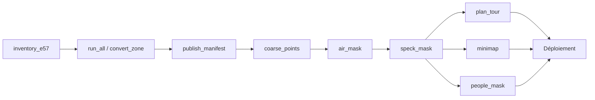

# 3. Le pipeline hors ligne

Tous les scripts sont dans [`pipeline/`](../pipeline). Ils s'installent ainsi :

```bash
python3 -m venv .venv
.venv/bin/pip install -r pipeline/requirements.txt
```

Vue d'ensemble :

| Script | Rôle | Où il tourne | Sortie |
| --- | --- | --- | --- |
| `inventory_e57.py` | Lit l'en-tête de chaque E57 | Sandbox | `inventory.jsonl` |
| `check_registration.py` | Mesure le recalage entre quelques scans | Local | Texte |
| `build_octree.py` | Premier prototype, un octree en local | Local | `data/out/` (ancien format) |
| `convert_zone.py` | Convertit une zone du Drive vers le Blob | Sandbox | Blob, `report_<zone>.json` |
| `run_all.py` | Enchaîne toutes les zones, avec plafond de dépense | Sandbox | Journaux, rapports |
| `publish_manifest.py` | Écrit la liste des zones publiées | Local | `manifest.json` |
| `coarse_points.py` | Relit les niveaux grossiers depuis le Blob | Local | Cache `.npz` |
| `air_mask.py` | Masque de ce qui flotte dans l'air | Local | `air-mask.bin` |
| `speck_mask.py` | Masque des points isolés et des boules d'échos | Local | `speck-mask.bin` |
| `plan_tour.py` | Calcule le parcours | Local | `tour.json` |
| `minimap.py` | Dessine le plan isométrique | Local | `minimap.png`, `minimap.json` |
| `people_mask.py` | Masque de l'équipe de relevé et des trépieds | Local | `people-mask.bin` |

## 1. Inventaire : `inventory_e57.py`

```bash
python3 inventory_e57.py grainetiere: inventory.jsonl
```

Un fichier E57 commence par un en-tête de 48 octets qui indique où se trouve sa description XML, près de la fin du fichier. Deux lectures partielles par fichier suffisent donc (`rclone cat --offset --count`), sans lire aucun point. Le script retire au passage le CRC de 4 octets présent à la fin de chaque page E57. Il n'utilise que la bibliothèque standard, avec 8 lectures en parallèle.

## 2. Vérification du recalage : `check_registration.py`

```bash
python check_registration.py scan1.e57 scan2.e57 …
```

Il garde les points à moins de 12 m de chaque scanner, en tire 400 000 au hasard, et affiche la distance médiane entre scans qui se recouvrent. C'est un outil de contrôle ponctuel.

## 3. Conversion : `convert_zone.py`

```bash
PATH=$PWD:$PATH BLOB_HEADERS=$PWD/blob_headers.txt \
  python convert_zone.py cuisine --inventory inventory.jsonl
```

### Étapes

**a. Répartition en tuiles (`bin_scan`).** Pour chaque scan de la zone :

1. copie du Drive vers le disque avec `rclone copyto` ;
2. lecture par tranches de 8 millions de points, car les plus gros scans en ont 170 millions ;
3. retrait des points invalides, application de la pose, retrait de ce qui sort du cube ;
4. dédoublonnage à `MIN_SPACING` (5 mm), d'abord dans chaque tranche puis sur tout le scan ;
5. écriture en tuiles de 16 m (`RECORD` : 3 × u16 + u8, soit 7 octets par point), en ajout de fichier ;
6. suppression du scan.

**b. Construction de chaque tuile (`build_tile`), de la plus petite à la plus grosse.**

1. fusion des scans (`merged_tile`) : un point par cellule de 3,9 mm, quel que soit le scan ;
2. mélange aléatoire reproductible, pour que chaque niveau soit un échantillon uniforme ;
3. mise de côté des points des 5 niveaux au-dessus de la tuile, partagés avec les tuiles voisines ;
4. descente de l'arbre : chaque nœud garde le premier point de chaque cellule de sa grille 128³ et passe le reste à ses 8 enfants ;
5. écriture de chaque nœud par `Writer`, qui compresse et envoie sur Blob à chaque tranche de 90 Mio.

**c. Fin de zone.** Les niveaux hauts sont écrits en dernier, puis `metadata.json.gz` et `report_<zone>.json`.

### Tenir en mémoire

| Risque | Parade |
| --- | --- |
| Tuile énorme, centaines de millions de points empilés | Au-delà de `BIG_TILE_BYTES` (200 Mo), découpage sur disque en 512 parties, traitées l'une après l'autre (`merged_tile`) |
| Plusieurs grosses tuiles en même temps | `HeavyLock` : un seul processus à la fois, verrou `flock` sur `heavy.lock` |
| Disque plein | Suppression immédiate de chaque scan, tuile et morceau traité |

### Mesure du recalage (`plane_gaps`)

Pour les 3 paires de scans les plus proches de la zone, le script prélève les points à moins de 4 m de leur milieu, ajuste un plan local sur un scan et mesure la distance de l'autre scan à ce plan. C'est l'origine de `gapsMm` dans les rapports.

### Réglages

| Constante | Valeur | Effet |
| --- | --- | --- |
| `GRID` | 128 | Cellules par côté de nœud |
| `ROOT_SIZE` | 512 m | Côté du cube racine |
| `TILE_DEPTH` | 5 | Profondeur des tuiles, soit 16 m |
| `MIN_SPACING` | 5 mm | Finesse maximale |
| `MIN_NODE` | 2 000 | En dessous, un nœud garde tout et l'arbre s'arrête |
| `READ_POINTS` | 8 M | Taille des tranches de lecture |
| `CHUNK_BYTES` | 90 Mio | Taille des fichiers sur Blob |
| `BIG_TILE_BYTES` | 200 Mo | Seuil du découpage sur disque |

> **Écart entre le code et son commentaire :** l'en-tête de `convert_zone.py` mentionne `BLOB_READ_WRITE_TOKEN`, mais le script lit en réalité `BLOB_HEADERS`, le chemin d'un fichier d'en-têtes HTTP. Ce fichier contient deux lignes, `authorization: Bearer <jeton>` et `x-vercel-blob-access: public`, et ne doit jamais être publié.

## 4. Orchestration : `run_all.py`

```bash
PATH=$PWD:$PATH BLOB_HEADERS=$PWD/blob_headers.txt \
  nohup python run_all.py --workers 3 --budget 30 > run_all.log 2>&1 &
```

- Il traite les zones de la plus légère à la plus lourde, 3 à la fois.
- Il saute les zones qui ont déjà un `report_<zone>.json`, donc on peut le relancer sans perte.
- Une zone en échec est nettoyée puis retentée seule, une fois les autres finies.
- Il estime la dépense à partir de `/proc/stat` et n'ouvre plus de zone au-delà de `--budget`.

| Poste de l'estimation | Tarif retenu |
| --- | --- |
| CPU actif | 0,128 $ par vCPU-heure |
| Mémoire | 0,0212 $ par Go-heure, sur 16 Go |
| Envoi de données | 0,15 $ par Go |
| Marge | × 1,3 |

Ces tarifs sont ceux relevés au moment de la conversion, à revérifier avant de relancer.

### Préparer un Sandbox

Aucun script ne prépare le Sandbox : voici la marche suivie.

```bash
cd app
vercel sandbox create --project grainetiere-nuage --runtime python3.13 --vcpus 8 --timeout 3h
```

Puis, dans le Sandbox (`vercel sandbox exec <id> -- sh -c '…'`, et `vercel sandbox cp` pour les fichiers) :

1. installer le binaire `rclone` dans `~/work` ;
2. créer un environnement Python avec `numpy`, `scipy`, `pye57` ;
3. copier `rclone.conf`, `convert_zone.py`, `run_all.py`, `inventory.jsonl`, `blob_headers.txt` ;
4. passer `rclone.conf` et `blob_headers.txt` en droits 600 ;
5. lancer `run_all.py`.

L'accès au Drive a été révoqué et le remote `rclone` supprimé après la conversion : toute nouvelle lecture demande une nouvelle autorisation. L'identifiant Google partagé de `rclone` doit de plus être retiré courant 2026, il faudra sans doute créer un identifiant propre.

## 5. Manifeste : `publish_manifest.py`

```bash
python publish_manifest.py manifest.json buanderie cuisine …
```

Il écrit la liste des zones nommées en ligne de commande avec leur libellé français (`LABELS`). Une zone absente de `LABELS` fait échouer le script : rien n'est publié par accident. L'envoi sur le Blob se fait ensuite à part :

```bash
curl -sS -X PUT --upload-file manifest.json -H "@blob_headers.txt" \
  -H "x-add-random-suffix: 0" -H "x-allow-overwrite: 1" \
  -H "x-content-type: application/json" -H "x-cache-control-max-age: 60" \
  "https://vercel.com/api/blob/?pathname=abbaye/manifest.json"
```

## 6. Base des analyses : `coarse_points.py`

Ce module relit depuis le Blob, zone par zone, les niveaux jusqu'à `COARSE_DEPTH` (6, soit 6,25 cm entre points), et les garde en cache dans un dossier `.npz`. Un point isolé se retrouve toujours dans les niveaux grossiers, puisqu'une cellule vide garde le premier point qui s'y présente : ces niveaux suffisent donc pour repérer tout point isolé.

```bash
python pipeline/coarse_points.py /chemin/du/cache
```

Tous les scripts suivants prennent ce dossier de cache comme premier argument. Il n'y a besoin d'aucun secret : les fichiers sont publics.

## 7. Masque de l'air : `air_mask.py`

```bash
python pipeline/air_mask.py cache app/src/air-mask.bin [prefixe_images]
```

Sur une grille de 40 cm (`VOXEL`) :

1. les cellules d'au moins 6 points (`SOLID_POINTS`) forment des pièces, réelles à partir de 12 cellules (`MIN_PIECE`) ;
2. les cellules directement voisines restent (brindilles, arêtes) ;
3. une cellule clairsemée entourée d'au moins 10 cellules occupées (`CROWD_CELLS`) reste aussi, comme dans un feuillage ;
4. ce qui est à moins de 80 cm du sol reste (`GROUND_MARGIN`) ;
5. les petits groupes en hauteur, de moins de 60 cellules (`SMALL_PIECE`), partent.

Le troisième argument, facultatif, produit des vues de contrôle en PNG. Les seuils ont été réglés à l'œil sur ces images.

## 8. Masque des points isolés : `speck_mask.py`

```bash
python pipeline/speck_mask.py cache app/src/speck-mask.bin
```

Sur une grille de 12,5 cm (`FINE_VOXEL`), une surface montre plusieurs voisins dans une fenêtre de 5 cellules, contre 3 au plus (`MAX_NEIGHBOURS`) pour un point isolé. Le calcul avance par blocs de 256 cellules pour tenir en mémoire.

S'y ajoutent les cellules à moins de 30 cm de chaque position de scanner (`SCANNER_BALL`) : un scanner enregistre une petite boule de faux échos autour de lui, à une distance où il ne peut pas mesurer de vraie surface.

## 9. Parcours : `plan_tour.py`

```bash
python pipeline/plan_tour.py cache app/src/air-mask.bin,app/src/speck-mask.bin app/src/tour.json [controle.png]
```

### Les arrêts : `ROUTE`

La visite est écrite à la main dans `ROUTE` : une liste ordonnée de lieux, chacun avec ses arrêts.

```python
("refectoire_moines", [stop(14, -14.5, look=(11, -22), sweep=130)]),
```

| Paramètre | Sens |
| --- | --- |
| `x, y` | Position en mètres dans le repère du projet |
| `z` | Hauteur des yeux. Par défaut, celle de la station de rez-de-chaussée la plus proche |
| `look` | Point à regarder. Par défaut, le côté le plus ouvert |
| `sweep` | Amplitude du balayage du regard, en degrés |
| `via` | Passage sans arrêt |

### Le calcul

1. **Grille (`Grid`).** Cellules de 20 cm sur toute l'abbaye. Une cellule est pleine si elle contient un point d'intensité d'au moins 8 (`MIN_TONE`), hors masques. Pour chaque cellule : distance à l'obstacle le plus proche, et hauteur au-dessus de ce qu'il y a dessous.
2. **Où l'on peut marcher (`walkable_cells`).** À au moins 30 cm de tout (`CLEARANCE`) et à hauteur d'yeux au-dessus d'un sol (`EYE` 1,5 m, à 45 cm près). Les petits trous du sol sont comblés, et une zone autour de chaque arrêt reste toujours permise.
3. **Graphe (`walk_graph`).** Chaque cellule est reliée à ses 26 voisines, avec un coût qui pénalise la proximité des murs.
4. **Chemins.** Dijkstra de chaque arrêt au suivant. Deux lieux sont reliés à pied si le chemin existe, fait moins de 45 m (`LINK_MAX`) et monte de moins de 1,5 m (`LINK_MAX_RISE`). Sinon, une nouvelle chaîne commence et le visiteur passe par un fondu : porte fermée, escalier à vis.
5. **Regard et allure (`timeline`).** À chaque arrêt, le regard balaie à 9°/s (`SWEEP_SPEED`). En marche, à 0,6 m/s (`WALK_SPEED`), il se tourne vers le côté le plus ouvert. Il est lissé pour ne pas dépasser 15°/s (`MAX_TURN`). Le tangage se relève sous les hauts plafonds.
6. **Écriture.** Une clé par seconde. Un lieu commence à 70 % de la marche qui y mène (`TITLE_AT`), pour que le titre apparaisse à l'approche.

Le script affiche pour chaque chaîne l'écart minimal aux obstacles et la rotation maximale. Ce sont les deux chiffres à contrôler après une modification.

### Modifier le parcours

1. Modifier `ROUTE`. Chaque lieu doit avoir son entrée dans `places.json`.
2. Relancer le script ; les niveaux grossiers en cache évitent de tout retélécharger.
3. Regarder le résultat dans le visualiseur. Tant que l'arrêt fait face à un mur proche, c'est en général `look` et `sweep` qu'il faut changer.

**Le parcours influe sur le préchargement :** les visiteurs qui ont déjà préchargé la visite ne disposeront pas des nouveaux nœuds, qui seront chargés par le réseau ou signalés comme manquants.

## 10. Plan : `minimap.py`

```bash
python pipeline/minimap.py cache app/src/air-mask.bin,app/src/speck-mask.bin app/src/minimap.png app/src/minimap.json
```

Il dessine une vue isométrique depuis le sud-ouest, alignée sur l'axe des bâtiments (`AXIS_ANGLE`, −19°).

1. **Murs.** Dans les contours `BUILT` tracés à la main, une cellule de 25 cm est un mur si ses points occupent au moins 80 % (`WALL_SHARE`) d'une tranche de hauteur (`SLICE`), plus haute pour l'église sans voûtes (`CHURCH_SLICE`). Les pièces de moins de 30 cellules (`MIN_PIECE`) partent.
2. **Toits.** Dans les contours `ROOFED` et `ROOFED_TOWERS`, la hauteur vient des points les plus hauts, lissée. Ils sont dessinés en tuiles rouges (`TILE`), à 74 % d'opacité (`ROOF_ALPHA`), sur un calque à part pour que les transparences ne s'additionnent pas.
3. **Sol et haies.** Le contour du terrain (`SITE`) et les haies qui dessinent l'église (`HEDGES`) sont tracés à la main.

## 11. Silhouettes et trépieds : `people_mask.py`

```bash
python pipeline/people_mask.py cache app/src/people-mask.bin app/src/air-mask.bin app/src/speck-mask.bin
```

Le calcul prend environ 2 minutes, sur une grille de 10 cm (`VOXEL`).

1. **Séparer le bâti.** Les grands plans horizontaux et les colonnes verticales d'au moins 2,1 m (`WALL_RUN`) sont retirés. Ce qui reste forme les pièces candidates.
2. **Trépieds (`tripods`, `legs_of`).** Sous une position de scanner, le script cherche au moins 2 jambes droites qui descendent en s'écartant, avec un vrai sol dessous et du vide autour. Seules les cellules des jambes sont masquées.
3. **Personnes (`analyse`, `one_sided`).** Une pièce doit reposer sur un sol, culminer entre 1 et 2,1 m, rester petite et à l'écart des murs. Surtout, au moins 85 % de la pièce (`MIN_SINGLE`) doit former une coque vue d'une seule station, sans dos, alors qu'une autre station avait une vue dégagée. Un objet réel a été vu de plusieurs côtés et échoue à ce test. Le seuil passe à 93 % pour une pièce large (`WIDE_SINGLE`) et à 65 % en plein air (`OPEN_SINGLE`).
4. **Masque final.** Les petits restes voisins d'une personne s'y ajoutent, puis une cellule de plus autour, sans jamais toucher le bâti.

La grille du fichier couvre tous les points, pour qu'un point lointain ne puisse pas tomber sur un numéro de cellule masquée. Le résultat et ses limites sont décrits dans [les chantiers](06-limites-et-droits.md#masquer-les-silhouettes-de-léquipe-de-relevé).

### Morceaux pour le nettoyage à la main : `pieces_mask.py`

```bash
python pipeline/pieces_mask.py cache app/src/people-mask.bin app/src/pieces-mask.bin app/src/air-mask.bin app/src/speck-mask.bin
```

Le script reprend la séparation du bâti de `people_mask.py`, garde tous les morceaux jusqu'à 3 000 cases (`MAX_CELLS`) et note ceux qui n'ont rien autour d'eux (`LOOSE_REACH`). Il lit la grille dans `people-mask.bin` pour que les numéros de cases restent les mêmes. Le fichier ne sert que sur `?nettoyage=1` : un clic retire un morceau entier, un curseur retire d'un coup les morceaux isolés, et le pinceau ne touche plus au bâti sans `Alt`.

## Ordre de reconstruction



Pour toute modification postérieure à la conversion, seules les étapes à partir du changement sont à refaire, et le Blob ne bouge pas.
