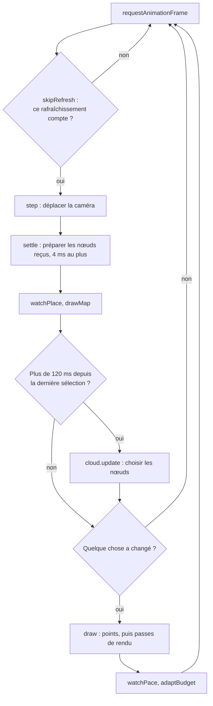
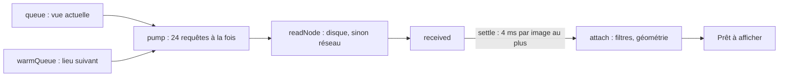
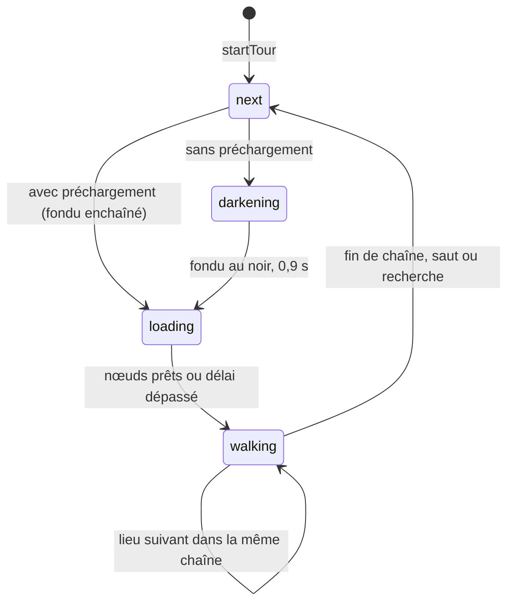

# 4. Le visualiseur

Le code tient dans quatre fichiers :

| Fichier | Lignes | Contenu |
| --- | --- | --- |
| [`app/src/main.js`](../app/src/main.js) | 1 951 | Rendu, caméra, visite, ciel, interface |
| [`app/src/cloud.js`](../app/src/cloud.js) | 596 | Octree, sélection, chargement, filtres, mémoire |
| [`app/src/music.js`](../app/src/music.js) | 101 | Lecteur audio |
| [`app/index.html`](../app/index.html), [`style.css`](../app/src/style.css) | 164 + 461 | Interface |

## Le cycle d'une image

`frame()` s'exécute à chaque rafraîchissement de l'écran :



Sans mouvement ni donnée nouvelle, `dirty` reste faux et rien n'est redessiné. La page ne consomme alors presque rien.

## Du nuage à l'écran : `cloud.js`

### Démarrage : `loadAbbey`

1. Lecture de `manifest.json`, sans cache.
2. Lecture des `metadata.json.gz` des 28 zones, décompressés avec `DecompressionStream`. Certains hébergeurs le font déjà via `Content-Encoding` : la fonction `gunzipIfNeeded` le détecte aux deux premiers octets.
3. Lecture des masques. S'il en manque un, la vue fonctionne quand même : avec un peu plus de bruit pour les deux premiers, sans le bouton des silhouettes pour `people-mask.bin`.

`PointCloud.buildTree` crée ensuite un arbre par zone, en ajoutant les ancêtres vides : les niveaux hauts peuvent ne rien contenir dans une petite zone.

### Choisir les nœuds : `update`

Chaque sélection est une file de priorité sur tous les arbres :

```text
priorité = espacement à l'écran / √distance
```

Elle favorise les surfaces proches, celles que l'œil lit, et qu'aucun mur ne cache. Un nœud est écarté si :

- il est hors du champ de vision ;
- il est caché (`isOccluded`, voir plus loin) ;
- ses points seraient à moins de 1,2 pixel les uns des autres ;
- le budget de points est atteint.

Pour éviter les à-coups, `MAX_NEW_POINTS` limite à 1,5 million les points nouvellement montrés à chaque sélection. Le reste attend la suivante.

### Occlusion : `isOccluded` et `refreshOcclusion`

Toutes les 400 ms, l'image de distances est réduite 16 fois (2 passes de `reducePass`, `OCCLUSION_STEP` = 4) et relue sans bloquer (`readRenderTargetPixelsAsync`). La carte obtenue donne la plus grande distance visible par bloc de 16 pixels. Un bloc presque vide compte comme une ouverture.

Un nœud est caché si, sur toute sa surface à l'écran, la carte montre quelque chose de plus proche que son point le plus proche, à 3 % près et 50 cm près. Seuls les nœuds de profondeur au moins égale à 5 sont testés (`MIN_OCCLUSION_DEPTH`). C'est ce qui permet de consacrer le budget de points à la pièce où l'on se trouve plutôt qu'aux pièces voisines. L'occlusion n'existe qu'en rendu amélioré, et elle est remise à zéro à chaque saut vers un autre lieu.

### Charger : `pump`, `load`, `settle`, `attach`



- **`concurrency` = 24 requêtes à la fois.** Avec 6, le chargement plafonnait autour de 90 nœuds/s ; avec 24, on mesure environ 300 nœuds/s.
- **`settle`** étale la préparation des nœuds, pour qu'une rafale de données ne fasse pas manquer une image.
- **La file `warmQueue`** ne passe qu'après ce qui est à l'écran.

### Filtres à la lecture : `attach`

Dans chaque nœud reçu, dans l'ordre :

1. **Masques (`dropAirPoints`).** Écarte les points tombant dans une cellule listée.
2. **Points sans voisins (`keepSurroundedPoints`).** Le nœud est découpé en 32³ cellules ; un point dont la cellule et ses voisines contiennent au plus `ISOLATED` (2) points est écarté.
3. **Amas flottants (`floatingCells`).** Jusqu'à la profondeur 8, un amas de moins de 7 cellules, sans contact avec le bord du nœud, est écarté. Au contact du bord, il peut simplement se prolonger dans le nœud voisin.

4. **Silhouettes et trépieds (`moveTracesLast`).** Ces points ne sont pas retirés : ils sont rangés en fin de nœud, et `cleanCount` retient où ils commencent.

Enfin, le shader de sommets rejette les points trop sombres (`uMinTone`), qui sont des échos sur les arêtes : ils ne sont pas retirés des données, simplement envoyés hors de l'écran.

### Masquer les silhouettes : `hideTraces`

Le bouton change la plage dessinée de chaque géométrie (`setDrawRange`), de `keptCount` à `cleanCount` ou l'inverse. Le changement est immédiat, sans rechargement ni transfert. Les nœuds qui arrivent ensuite reçoivent la même plage. Le bouton reste caché si le masque n'a pas pu être lu, et les silhouettes sont visibles par défaut.

### Mémoire : `evict`

Quand les points en mémoire dépassent le double du budget, les nœuds invisibles et sans enfant chargé sont libérés, les plus anciens d'abord.

### Taille d'un point

```glsl
gl_PointSize = uSize * clamp(1.5 * uSpacing * uScale / distance, uMinSize, uMaxSize);
```

`uSpacing` vient de `drawSpacing`, l'espacement du descendant visible le plus fin : un parent dont les enfants sont affichés peut garder de petits points.

## Le rendu

Les points sont d'abord dessinés dans une cible hors écran (`target`), avec une texture de profondeur. La suite dépend du mode.

### Mode « Points bruts » : EDL

Une passe (`edl`) assombrit chaque pixel selon l'écart de profondeur avec ses 8 voisins : c'est l'*eye-dome lighting*, sans lequel des points sans couleur restent illisibles.

### Mode « Amélioré », par défaut

Il demande WebGL 2 et `EXT_color_buffer_float`, sinon le bouton est désactivé.

| Passe | Rôle |
| --- | --- |
| `seedPass` | Réunit couleur et distance dans une même texture flottante |
| `fillPass` × 3 (rayons 1, 2, 4) | Comble les trous et cache ce qui transparaît |
| `shadePass` | Calcule normales, éclairage, ombrage de contact, brume et ciel |

**`fillPass`** applique un opérateur de visibilité en espace écran (d'après Pintus et al. 2011, Bouchiba et al. 2017). Un pixel entouré de plus proche que lui sur au moins 3 axes opposés est dans un trou de la surface : il prend la moyenne des voisins les plus proches. Inversement, un point isolé devant tout le reste est considéré comme du bruit. Au plus grand rayon, un point seul dans le vide est effacé.

**`shadePass`** fait tout le reste :

- **Normales :** déduites de l'image de distances, sur 5 pixels d'écart pour ne pas prendre le bruit de mesure pour du relief.
- **Lumière :** `(0,62 + 0,2 nz) × ambiante + 0,4 × max(n·soleil, 0) × soleil`. Il n'y a pas d'ombres portées : il faudrait des surfaces pour les calculer.
- **Ombrage :** arêtes à 1,5 pixel, ombrage de contact à 8 pixels.
- **Grain :** moyenne avec les voisins de la même surface, contre le grain de l'intensité laser.
- **Brume :** `1 − exp(−z / 600)`.
- **Ciel :** dégradé, halo, disque solaire et étoiles, sur les pixels vides.

## Le ciel

- **`sunDirection`** calcule la position réelle du soleil à l'abbaye (46,84° N, 1,03° O). Contrôle à l'abbaye : 27,4° à midi le 5 novembre, 66,6° au solstice.
- **`SKY_STAGES`** donne les couleurs selon la hauteur du soleil, à −18°, −6°, 0°, 8°, 25° et 60°, avec interpolation entre deux paliers. La nuit, l'ambiante reste assez forte pour lire le bâtiment.
- **`abbeyHour`** utilise le fuseau `Europe/Paris`, quel que soit celui du visiteur.
- **Par défaut,** le ciel suit l'heure réelle et se rafraîchit chaque minute (`SKY_REFRESH`). Le curseur passe en heure choisie, le bouton « Heure réelle » y revient.

## La visite guidée

### Machine à états : `stepTour`



| Phase | Ce qui se passe |
| --- | --- |
| `next` | Sans préchargement, le fondu au noir commence. Avec, `holdLastPicture` fige la dernière image et le saut a lieu |
| `darkening` | Fondu de `TOUR_FADE` (0,9 s), puis `arriveAtNextPlace` |
| `loading` | Attente des nœuds : au plus `TOUR_MAX_WAIT` (6 s), ou `DISSOLVE_MAX_WAIT` (1,2 s) avec préchargement |
| `walking` | Avance dans les clés, sauf si `held` (pause) ou `reading` (texte détaillé ouvert) |

### Lecture des clés : `placeOnTour`

La position et le regard sont interpolés par une spline de Catmull-Rom entre les clés, une par seconde. La vitesse de défilement s'applique au temps : `tour.time += dt × vitesse / TOUR_SPEED`.

### Préparer le lieu suivant : `warmNextPlace`

`WARM_LEAD` (15 s) avant la fin d'une chaîne, le visualiseur calcule les nœuds de la première vue du lieu suivant et les confie à la file `warmQueue`. Le fondu trouve ainsi la pièce suivante en grande partie chargée.

### Reprendre à l'instant près

- **Pause :** `tour.held`, rien d'autre ne change.
- **Clic dans l'image ou touche de déplacement :** `stopTour` mémorise `tourLeftAt` (lieu, instant, position, regard, allure). Le bouton devient « Reprendre la visite ». Si la caméra n'a pas bougé, la visite repart sans transition ; sinon, elle revient par le fondu.
- **Choix dans « Se rendre à » :** oublie ce point de reprise (`forgetTour`).

### Recherche dans la visite : `seekTour`, `setupSeek`

La barre fonctionne comme celle d'une vidéo, avec une bulle indiquant l'instant et le lieu. `tourMoment` convertit des secondes de visite en un lieu et un instant, `tourClock` fait l'inverse.

- Dans la même chaîne, à moins de `SEEK_KEEP_PLACE` (6 s) : saut direct.
- Sinon : passage par le fondu.
- Au clavier : flèches gauche et droite, ±10 s (`SEEK_KEY_STEP`).

Les boutons de part et d'autre mènent aux lieux précédent et suivant (`jumpTour`). Plusieurs appuis s'additionnent.

### Champ de vision

Pendant la visite, le champ s'élargit jusqu'à 115° horizontaux (`TOUR_WIDTH`), plafonnés à 100° verticaux (`TOUR_MAX_FOV`), avec une transition douce. En visite libre, il revient à 70° (`NORMAL_FOV`).

## Le préchargement

`?precharger=1`, sur ordinateur uniquement, propose de télécharger la visite à l'avance.

1. **`tourNodes`** rejoue la visite sans rien charger : toutes les 2 clés (`PRELOAD_KEY_STEP`), il liste les nœuds qu'il faudrait, avec une marge de budget de 1,5 (`PRELOAD_MARGIN`), puisque les murs laissent de la place pour du détail supplémentaire.
2. **`offer`** compare à ce qui est déjà conservé, et annonce le volume et la place disponible. La vérification se fait nœud par nœud, 64 à la fois (`PRELOAD_CHECKS`) : Chromium refuse de lister d'un coup un cache de cette taille (`Operation too large`).
3. **`download`** télécharge à 12 requêtes simultanées (`PRELOAD_PARALLEL`), avec 4 essais par nœud, dans le Cache Storage `grainetiere-points-1`, et demande un stockage persistant.
4. Pendant la visite, `readNode` regarde d'abord dans ce cache. Le fondu au noir devient un fondu enchaîné.

Le préchargement se relance sans perte : seuls les nœuds manquants sont demandés. Après un changement de parcours, le volume annoncé change. Le volume dépend aussi de la taille de la fenêtre : 4,04 Go en 1512 × 860, calculés sans téléchargement complet.

Si le navigateur refuse son espace de stockage (navigation privée, cache abîmé), `showStoreFailure` l'explique et propose d'effacer la visite gardée. La visite reste possible par le réseau.

## La fluidité

**Rythme régulier (`skipRefresh`).** Sur un écran rapide (rafraîchissement sous 12 ms), une image sur deux seulement est calculée. Une image régulière à 60 i/s paraît plus fluide qu'un rythme variable autour de 100.

**Allègement automatique (`watchPace`, `lightenLoad`), sur ordinateur et en marche seulement.** Toutes les 180 images (`LATE_WINDOW`), si plus de 4 % sont en retard (`LATE_SHARE`), le budget baisse de 15 % jusqu'à 12 millions (`DESKTOP_MIN_BUDGET`), puis la résolution baisse jusqu'à un ratio de 1 (`MIN_PIXEL_RATIO`). Choisir le détail à la main, par le curseur, `?detail=` ou le profil Détaillé, désactive cet allègement.

**Mobile (`adaptBudget`).** De 2 à 12 millions de points (`TOUCH_BUDGET`, départ à 5) : le budget baisse de 20 % sous 22 i/s et monte de 15 % au-dessus de 40 i/s.

**Interface.** `setText` ne touche la page que si le texte a changé, et le plan n'est redessiné que toutes les 100 ms (`MAP_EVERY`).

> **Mesures en navigateur :** une fenêtre masquée ou hors de vue limite la page à 1 image/s. Les mesures de fluidité n'ont de sens qu'avec la fenêtre visible.

## L'interface

### Accueil, en deux étapes

Le visiteur choisit visite guidée ou libre, puis avec ou sans musique. Ce clic sert aussi à autoriser le son, ce que les navigateurs exigent. Le choix « guidée » lance la visite dès que le nuage est prêt (`ready`).

### Commandes

| Élément | Fonction |
| --- | --- |
| `#tour` | Lancer, mettre en pause, reprendre |
| `#tour-progress` | Barre de recherche, lieux précédent et suivant |
| `.speed` | Vitesse de défilement, aussi à la molette ou avec + et − |
| `#story-toggle` | Explications : texte court, texte détaillé à la demande. Le texte détaillé suspend la visite |
| `#mute`, `#music-open` | Musique |
| `#guide-open` | Aide : visite de l'interface |
| `.minimap` | Plan, position, direction du regard, parcours |
| `#goto` | Se rendre à : vue d'ensemble, lieu de visite ou zone du relevé |
| `#stations` | Positions de scanner de la zone, nommées selon leur place (`viewpointsOf`) |
| `#sky-box` | Lumière du ciel |
| `#hide-traces` | Masquer silhouettes et trépieds |
| `#fine-settings` | Profils, rendu, couleur (intensité ou hauteur), détail, taille des points, relief. Replié au départ sous 860 px de haut |
| `#stats` | Points affichés, images/s, chargement. Hauteur réservée pour que le panneau ne bouge pas |

### Profils (`PROFILES`)

| Profil | Millions de points | Taille des points | Relief |
| --- | --- | --- | --- |
| Fluide | 8 | 1,1 | 0,9 |
| Équilibré, par défaut | 16 | 1 | 1 |
| Détaillé | 28 | 0,9 | 1,2 |

Bouger un curseur à la main désélectionne le profil.

### Titre du lieu : `showPlaceTitle`

Centré à l'écran pendant 5 s (`PLACE_TITLE_CENTERED`), puis décalé en haut à droite pendant 5 s (`PLACE_TITLE_ASIDE`), puis effacé.

### Aide : `GUIDE_STEPS`, `setupGuide`

Onze fenêtres pointent chacune une commande, et celles qui ne sont pas à l'écran sont sautées. L'aide met la visite en pause et la relance en sortant. Le bouton attire l'attention jusqu'à la première ouverture (`localStorage.guideSeen`).

### Où est-on : `placeAt`, `watchPlace`

Le lieu courant est celui du point de parcours le plus proche, ou de la station la plus proche pour les pièces hors parcours (`OFF_TOUR_ZONES`). La hauteur compte double, car les étages sont proches. Le changement n'est retenu qu'après deux relevés identiques, pour éviter le clignotement le long d'un mur.

### Déplacements

| Action | Commande |
| --- | --- |
| Regarder | Glisser dans l'image |
| Avancer, reculer, décaler | Touches Z, Q, S, D sur clavier AZERTY (W, A, S, D en QWERTY), ou flèches |
| Monter, descendre | E et A (Q en QWERTY), ou Page précédente et Page suivante |
| Accélérer | Maj, ×4 |
| Sur écran tactile | Un doigt pour regarder, deux doigts pour avancer (pincer) et se déplacer (glisser) |

`event.code` désigne la touche physique, quel que soit le clavier.

### Mémorisé dans le navigateur (`localStorage`)

`musicVolume`, `storyOpen` et `guideSeen`.

### Musique : `music.js`

Lecture dans un ordre aléatoire, à la suite. Le volume passe par un `GainNode` car iOS ignore `audio.volume`. La musique se coupe quand l'onglet est masqué et reprend ensuite. Les quatre morceaux ont le même volume perçu et donc le même gain, 0,6.

## Paramètres d'adresse

| Paramètre | Effet |
| --- | --- |
| `precharger=1` | Propose le préchargement. Budget porté à 16 M, curseur limité à 16. Ignoré sur écran tactile |
| `detail=<millions>` | Fixe le budget de points, jusqu'à 40. Ignoré sur écran tactile. Désactive l'allègement |
| `lieux=<id,id>` | Limite la visite à ces lieux |
| `zone=<id>` | Démarre dans cette zone |
| `station=<suffixe>` | Démarre à cette station de la zone |
| `yaw=`, `pitch=` | Direction initiale du regard, en radians |
| `data=<url>` | Lit les points depuis une autre adresse |

Exemple : `?precharger=1&lieux=cloitre,nef&detail=12`.

## Pour le débogage

`window.__nuage` donne accès, depuis la console, à `camera`, `look`, `applyLook`, `draw`, `step`, `renderer`, `music`, `cloud`, `tour`, `tourPlan`, `showPlaceTitle` et `sunDirection`.

```js
__nuage.cloud.pointBudget        // budget de points
__nuage.cloud.networkReads       // nœuds lus sur le réseau
__nuage.cloud.storeReads         // nœuds lus dans le préchargement
__nuage.cloud.droppedPoints      // points écartés par les filtres
```
